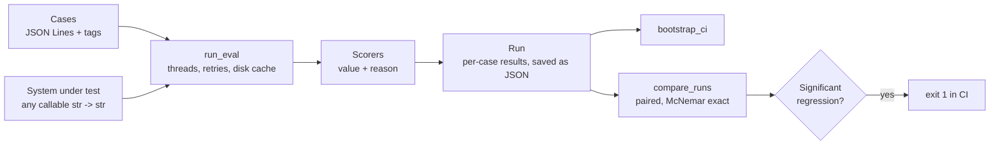

# llm-eval-harness

A small harness for evaluating LLM outputs with statistical honesty: scorers that explain themselves, concurrent cached runs, confidence intervals on every score, and a regression gate that fails CI only when a drop is unlikely to be noise.

No runtime dependencies. Python 3.10+.

## The problem it addresses

"Prompt v2 scored 87%, v1 scored 73%, ship it" hides three questions:

1. **Is the difference real?** On 80 cases, each score carries several points of uncertainty.
2. **What got worse?** An overall gain can hide a category that collapsed.
3. **Why did a case fail?** A bare 0 is not actionable.

## Demo output

`python -m evalkit demo`. No model is called: two versions of a rule-based invoice extractor stand in for two prompt versions, so the numbers are reproducible. The 80 cases are synthetic sentences in five groups.

| System | Overall | 95% CI | plain | separators | currency_word | distractor | symbol_after | Valid JSON |
|---|---:|---|---:|---:|---:|---:|---:|---:|
| extractor-v1 | 0.733 | 0.679 to 0.787 | 1.000 | 0.667 | 0.333 | 0.667 | 1.000 | 0.800 |
| extractor-v2 | 0.867 | 0.808 to 0.925 | 1.000 | 1.000 | 1.000 | 1.000 | 0.333 | 0.800 |

```
v2 vs v1 on fully-correct cases: fixed 48, broke 16, McNemar exact p = 7.7e-05,
mean difference +0.133 (95% CI +0.033 to +0.229)

Example extractor-v2 failure [case-004]: wrong fields: ['amount', 'currency']
  input:  Invoice INV-2928 from Northgrid Power totals 278 ₹.
  output: {"invoice_id": "INV-2928", "amount": null, "currency": null}
```

That is the whole argument for the tool in one run. v2 is better overall and the improvement is statistically solid, **but it broke 16 cases v1 handled**, all in one group (amounts written with the symbol after the number). A single headline number would have shipped that regression.

## What is in the box



| Scorer | Use it for |
|---|---|
| `ExactMatch`, `Contains`, `RegexMatch` | Classification, short answers, formats |
| `NumericClose` | Calculations, with relative or absolute tolerance |
| `TokenF1` | Free-text answers with partial credit (the SQuAD metric) |
| `JsonValid` | Structured output: parses, has required keys and types. Tolerates code fences |
| `JsonFields` | Extraction: share of fields correct |
| `LLMJudge` | Rubric grading by a model. An unparseable verdict scores 0 |

**Statistics, briefly.**
- `bootstrap_ci` resamples cases to put an interval on a mean.
- `compare_runs` pairs the two runs case by case, which removes the noise from some cases just being harder.
- `mcnemar_exact` asks whether the cases that flipped are lopsided enough to rule out chance. Five flips in one direction and none back gives p = 0.0625, which is not yet significant; six gives 0.031. A test pins those values.

**Runner behaviour.**
- A case whose call keeps failing is retried with exponential backoff, then recorded with score 0 and its error. It stays in the denominator, so flaky infrastructure cannot quietly inflate a score.
- Outputs are cached on disk by system name and input, so adding a scorer re-scores without calling the model again.

## Use it

```python
from evalkit import load_cases, run_eval, JsonValid, JsonFields, bootstrap_ci, compare_runs

cases = load_cases("data/extraction.jsonl")
scorers = [JsonValid({"amount": int, "currency": str}), JsonFields()]

run = run_eval("prompt-v2", call_my_model, cases, scorers, workers=8, cache_dir=".evalcache")
run.mean("json_fields"); run.by_tag("json_fields"); bootstrap_ci(run.values("json_fields"))
for failure in run.failures("json_fields")[:5]:
    print(failure.case_id, failure.reasons["json_fields"], failure.output)
run.save("runs/prompt-v2.json")
```

Gate a pull request:

```bash
python -m evalkit compare runs/main.json runs/pr.json --scorer json_fields   # exit 1 on a significant regression
```

```bash
pip install -e ".[dev]"
pytest -q            # 13 tests
python -m evalkit demo
```

## Limits

- The demo systems are rule-based stand-ins and the cases are generated, so the demo numbers say nothing about any real model.
- `LLMJudge` is only as good as the judge. It should be checked against human labels before its scores are trusted; this repo does not include that calibration.
- McNemar treats each case as pass or fail, so it ignores partial-credit movement. The bootstrap interval on the paired difference covers that.
- With many scorers and tags, some "significant" differences will appear by chance. No multiple-comparison correction is applied.
